# How the algorithm works

How a word is drawn, region by region, and why a failed drawing rules it out. How each step
maps onto the code is in [implementation.md](implementation.md).

## The question

Take the disk with $n$ punctures $p_1, \ldots, p_n$ on the real axis, and a *λ-line*
$\lambda_k$ from each $p_k$ up to the boundary point at the top of the circle. A path spells a word in $F_n$:
crossing $\lambda_k$ from left to right records $x_k$, and from right to left $x_k^{-1}$.

Every subword of a simple word is spelled by an embedded (non-self-crossing) arc. The
algorithm decides whether a word can be drawn as such an arc.
If it cannot, it is not a subword of any simple word.
Each end of the arc is either free, at an interior point, or on the boundary of
the disk, which is encoded using a `0` at the start or end of the word.

## An example

Take $x_1 x_3 x_2$ with $n = 3$. An arc for $x_1 x_3$ can only be drawn one way:

<p align="center">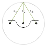</p>

The *head* of the arc is now in a region bounded by the arc, the boundary of the disk, and
segments of $\lambda_1$ and $\lambda_3$. It can only leave by crossing one of those segments, so
$\lambda_2$ is out of reach and $x_1 x_3 x_2$ cannot be drawn. The same picture rules out
$x_i x_k x_j$ for every $i < j < k$.

The algorithm automates this.
As the arc is drawn it cuts the disk into regions, and it records
which faces bound the region holding the head. In general, a letter can be drawn by crossing
any of several segments of one λ-line, and the choice changes the drawing. A word does not
determine a drawing, but a sequence of segment-face crossings does.

## Encoding

**Faces.** The arc cuts each λ-line into *segments*. A segment has two *faces*, labelled by one
integer $s$: the left face is $+s$ and crossing from it contributes a positive letter; the right
face is $-s$ and contributes a negative one. Initially $\lambda_k$ is one segment, with faces
$\pm k$.

**The boundary.** The boundary of the disk, less the point at the top of the circle, is treated as one more line,
for the letter `0`. It starts as the single segment `0` and is cut by arc ends that land on it.
It has one face per segment, the inside of the disk, so `0 = -0`, and it is never crossed.
An arc can only start or end on it.

**Regions.** A region is recorded as its *region tuple*: the faces on its boundary, read
clockwise. Tuples are cyclic, apart from the tuple which corresponds to the region which contains the head of the arc.
Drawn as a circle, a region tuple is a *region diagram*. Initially there is one
region, `(0, 1, -1, 2, -2, 3, -3)`. This reads around the boundary in a clockwise manner, then down and back up each λ-line.

<p align="center">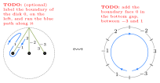</p>

**The dictionary.** A dictionary records which generator each segment belongs to. Initially
$k \mapsto x_k$, and every new segment inherits the generator of the segment it was cut from.

In the code:

| here | in the code |
|---|---|
| λ-line $\lambda_k$ | generator line `k` |
| head of the arc | the arc's *tip* |
| region tuple holding the head | `state.regions[0]` |
| face $\rho_i$ | `seg`, at `region[i - 1]` (the code indexes from 0) |
| the dictionary | `State.gen`, indexed by $\lvert s \rvert$ |
| next free label $T$ | `State.next_seg`, allocated by `_fresh_seg` |
| cases ρ = τ and ρ ≠ τ | Case A and Case B of `forward` |

## Drawing a word

**The first crossing.** Drawing $x_1$ splits the only segment of $\lambda_1$. The new segment
takes the next free label, `4`, and lies to the left of the arc. Its faces are inserted into the
region diagram, and the head emerges between `-1` and `-4`. The tail of the arc is irrelevant.

<p align="center">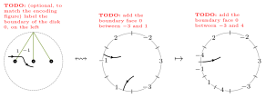</p>

```
(-4, 2, -2, 3, -3, 0, 4, 1, -1)        {1: x1, 2: x2, 3: x3, 4: x1}
```

By convention the head sits just before the first entry of the tuple.

**Subsequent crossings.** The next letter is $x_3$, and the only face of the head's region
carrying $x_3^{+1}$ is `3`, so the arc crosses it. This time the arc leaves the region and comes
straight back in, so it cuts the region in two. (The arc is drawn bottom to top.)

<p align="center">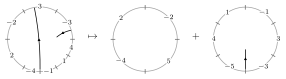</p>

```
((-5, 0, 4, 1, -1, 3, -3), (-4, 2, -2, 5))        {..., 5: x3}
```

The region holding the head is listed first.
The others are in no particular order. The last letter is $x_2$, but no face of the head's region corresponds (using the dictionary) to $x_2$, so the word
cannot be drawn.

Every crossing is one of a handful of cases, set out under [Region updates](#region-updates).

## Branching

For $x_1 x_3 x_1$ the last letter can be drawn by crossing face `4` or face `1`. Both give
valid drawings, but different ones, and that matters if the word goes on. So the algorithm
branches whenever several faces fit, and a word is drawable exactly when some branch reaches its
end.

The code advances every branch together, one letter at a time, as a set of states. Dead branches are dropped, and identical drawings reached in different ways merge.

## Signs, labels and the rank

Pushing an arc beneath a puncture removes every letter for that puncture, without creating a
crossing:

<p align="center">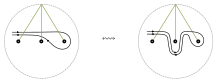</p>

So a puncture a word does not use is never an obstacle, and only the relative order of the
punctures it does use matters. Hence:

- the rank `n` can default to `max |letter|`, and any larger rank gives the same answer;
- `permute=True` reads the word as a shape by trying every relabelling of the symbols it
  contains, and never needs a symbol outside them;
- `respect_signs=False` asks whether *some* choice of exponents can be drawn, by trying each
  letter as both $x_j$ and $x_j^{-1}$.

## Co-existence

A family $w_1, \ldots, w_k$ *co-exists* if all its words can be drawn at once, as disjoint
embedded arcs. Subwords of one simple word always can, so a family that cannot co-exist does not
occur in any single simple word.

Draw $w_1$ and keep every configuration of regions it can end in. Start $w_2$ as a new arc in
any region of any of them, or on any boundary face if $w_2$ starts with `0`, and draw it as
before, then $w_3$, and so on. Disjointness comes for free: the head only crosses faces of its
own region, so it never crosses an arc already drawn. To consider possible relabellings, using the default `permute=True`, then the relabelling has to be applied to every word, $w_1, w_2, \ldots, w_k$, since they share a disk.

This is strictly stronger than testing words one at a time. `[1, 2, 1]` and `[3, 2, 3]` are each
drawable but not together. The boundary is especially restrictive, since a loop based on the
boundary cuts the disk in two, so `[0, 1, 0]` and `[2, 1, 2]` cannot co-exist, though `[1]` and
`[2, 1, 2]` can.

`[[1, 2, 1], [2, 3, 2]]` at $n = 3$, along one surviving branch:

```
start                   ((0, 1, -1, 2, -2, 3, -3),)
w1 = x1 x2 x1           ((-6, 5, -4), (-5, 3, -3, 0, 6), (4, 1, -1, 2, -2))
w2: new arc, cross 5    ((-7, 3, -3, 0, 6, -5), (-6, 7, 5, -4), (4, 1, -1, 2, -2))
    cross 3             ... splits off (-7, 8)
    cross -5            ... splits off (-5, 3, -3)                     5 regions
```

The last letter of $w_2$ has to be drawn as $x_2^{-1}$, which `respect_signs=False` finds. Like
the single-word test, co-existence is necessary but not sufficient: nothing checks that the arcs
join up into one simple loop.

## Region updates

Let $\rho = (\rho_1, \ldots, \rho_k)$ be the region tuple holding the head, which sits just
before $\rho_1$. The arc crosses the face $\rho_i = \varepsilon \lvert \rho_i \rvert$, with
$\varepsilon = \pm 1$. Its partner $-\rho_i$ is $\tau_j$, in a unique region tuple $\tau$, and
possibly $\tau = \rho$. Let $T$ be the next free label; the dictionary maps it to the generator
of $\lvert \rho_i \rvert$.

In each of the four crossing cases below, the crossed face becomes $(\varepsilon T, \rho_i)$ and its partner
$(\tau_j, -\varepsilon T)$, read clockwise. The head emerges between $\tau_j$ and
$-\varepsilon T$, so the region it lands in is rotated to begin at $-\varepsilon T$, and listed
first.

### Starting a new arc

```math
\rho \mapsto (\rho_1, \ldots, \rho_{i-1},\ \varepsilon T,\ \rho_i,\ \rho_{i+1}, \ldots, \rho_k) = \rho'
```
```math
\tau \mapsto (-\varepsilon T,\ \tau_{j+1}, \ldots, \tau_l,\ \tau_1, \ldots, \tau_j) = \tau'
```

Done in that order, this also covers $\tau = \rho$. The tail of the arc is a free point, so the
cut is a slit, not a chord: no region is split.

<p align="center">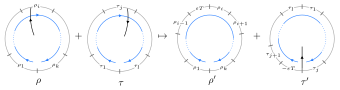</p>

`n = 2`, crossing `1`:

```
(0, 1, -1, 2, -2)  ->  (-3, 2, -2, 0, 3, 1, -1)
```

With the partner in another region, which only co-existence reaches: after `[1, 2]` at `n = 2`,
a new arc crossing `3`:

```
(-4, 0, 3, 1, -1, 2, -2), (-3, 4)  ->  (-5, 4, -3), (-4, 0, 5, 3, 1, -1, 2, -2)
```

### Continuing, ρ = τ and i < j

```math
\rho \mapsto (\rho_1, \ldots, \rho_{i-1},\ \varepsilon T) + (-\varepsilon T,\ \rho_{j+1}, \ldots, \rho_k,\ \rho_i, \ldots, \rho_j) = \rho'_L + \rho'_R
```

The arc leaves ρ and comes straight back in, so it cuts ρ along a chord. The head is in
$\rho'_R$.

<p align="center">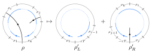</p>

`n = 2`, after `[1]`, crossing `2`:

```
(-3, 2, -2, 0, 3, 1, -1)  ->  (-4, 0, 3, 1, -1, 2, -2), (-3, 4)
```

### Continuing, ρ = τ and j < i

```math
\rho \mapsto (-\varepsilon T,\ \rho_{j+1}, \ldots, \rho_{i-1},\ \varepsilon T,\ \rho_1, \ldots, \rho_j) + (\rho_i, \ldots, \rho_k) = \rho'_L + \rho'_R
```

The same chord, but the head is in $\rho'_L$.

<p align="center">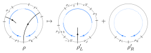</p>

`n = 3`, after `[1, 2]`, crossing `-1`:

```
(-5, 3, -3, 0, 4, 1, -1, 2, -2), (-4, 5)  ->  (6, -6, -5, 3, -3, 0, 4, 1), (-4, 5), (-1, 2, -2)
```

### Continuing, ρ ≠ τ

```math
\rho \mapsto (\rho_1, \ldots, \rho_{i-1},\ \varepsilon T) + (\rho_i, \ldots, \rho_k) = \rho'_L + \rho'_R
```
```math
\tau \mapsto (-\varepsilon T,\ \tau_{j+1}, \ldots, \tau_l,\ \tau_1, \ldots, \tau_j) = \tau'
```

The arc leaves ρ for a region cut off earlier. ρ is cut in two and neither half holds the head;
τ is not cut, only relabelled, and the head is in $\tau'$.

<p align="center">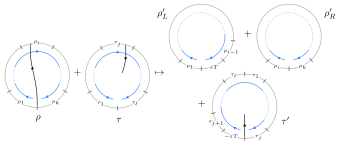</p>

`n = 2`, after `[1, 2]`, crossing `3`:

```
(-4, 0, 3, 1, -1, 2, -2), (-3, 4)  ->  (-5, 4, -3), (-4, 0, 5), (3, 1, -1, 2, -2)
```

The first examples under *Starting a new arc*, *ρ = τ and i < j* and *ρ ≠ τ* are the three
steps of drawing $x_1 x_2 x_1$ at $n = 2$.

### Starting on the boundary

A word beginning with `0` starts its arc on a boundary face $b = \rho_i$, which corresponds to generator `0`, crossing nothing. The start point splits $b$ into $(b, T)$, and the head now sits between the two:

```math
\rho \mapsto (T,\ \rho_{i+1}, \ldots, \rho_k,\ \rho_1, \ldots, \rho_i) = \rho'
```

Only the boundary segment, corresponding to $\rho_i$ is split in two. The next (first) crossing is a chord because the tail is fixed to the boundary.
It continues by one of the continuing cases (above), and adds a region.

<p align="center">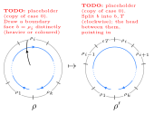</p>

`n = 2`, starting on `0`, then crossing `1`:

```
(0, 1, -1, 2, -2)  ->  (3, 1, -1, 2, -2, 0)                start on 0
                   ->  (-4, 2, -2, 0, 1, -1), (3, 4)       cross 1: ρ = τ, i < j
```

### Ending on the boundary

A word ending in `0` ends its arc on a boundary face $b = \rho_i$ of the head's region. The run
from the head to $b$ is a chord, so ρ is cut as in the case ρ ≠ τ, with $b$ split into $(T, b)$;
but there is no region beyond the boundary to take the head, and the arc is finished:

```math
\rho \mapsto (\rho_1, \ldots, \rho_{i-1},\ T) + (\rho_i, \ldots, \rho_k) = \rho'_L + \rho'_R
```

<p align="center">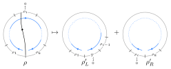</p>

Ending the last example on `0`, which draws `[0, 1, 0]`, a loop round $p_1$ based on the boundary:

```
(-4, 2, -2, 0, 1, -1), (3, 4)  ->  (3, 4), (-4, 2, -2, 5), (0, 1, -1)
```

The inside of the loop is `(0, 1, -1)`.

### Counting regions

Starting an arc adds no region, and every other step adds one. So $k$ arcs making $c$
crossings between them, with $b$ of their ends on the boundary, leave $c - k + b + 1$ regions.
